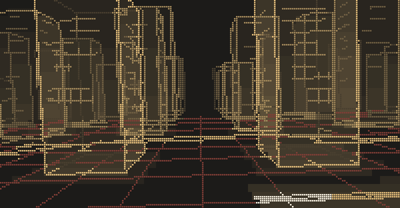
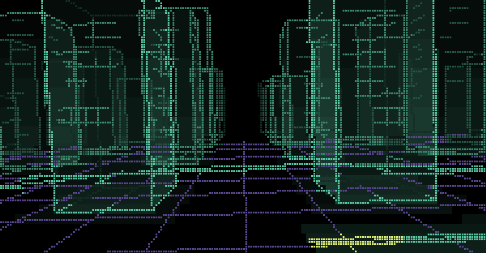

# cliamp-plugin-hack-the-gibson

A visualizer for [cliamp](https://github.com/bjarneo/cliamp): a flight through a city of glass towers, like the Gibson in Hackers (1995). Edges and code are drawn with Braille dots, the glass is a background tint behind them. All colors are configurable.

The camera flies low through the streets of an endless city and turns at crossings, one block per two beats (it just cruises when there is no beat). The city pulses with the music: on every beat the glass gets denser, the edges brighter, the towers jump and the picture zooms in a bit. The plugin tracks the tempo, so the pulse is on time even where it didn't catch the kick. On top of that:

- a kick sends a pulse of light down a street
- a snare runs a frame of light up or down the towers and lights the roof edges
- a hi-hat lights up lines of code
- a drop lifts the camera above the roofs for a moment
- every tower follows one band of the spectrum: it grows a bit and its glass gets denser while that band is loud

The scene is based on my CSS demo [Hack The Gibson](https://codepen.io/konstantindenerz/pen/poYmNxw).

## Install

```sh
cliamp plugins install konstantindenerz/cliamp-plugin-hack-the-gibson
```

Start cliamp and press `v` until you get to `Hack the Gibson`, or pick it with `Ctrl+V`. `V` toggles full screen. To start with it, set `visualizer = "Hack the Gibson"` in `config.toml`.

Needs cliamp 1.56 or newer. To uninstall:

```sh
cliamp plugins remove hack-the-gibson
```

## Themes

Terminal colors have no shades, and the towers need them: far ones fade out and the glass is a tint. So the plugin brings its own themes.

`Ctrl+T` switches to the next theme. The status bar shows its name and the choice is remembered. The key also shows up in the `Ctrl+K` list.

| Theme | |
|---|---|
| `mechanoonna` |  |
| `tokyo-night` |  |
| `catppuccin` |  |
| `gruvbox` |  |
| `hackers` |  |
| `kode` |  |

`mechanoonna` is the default, with the amber and red of the Ghostty theme [Mechanoonna](https://github.com/HANCORE-linux/omarchy-mechanoonna-theme). `catppuccin` is Mocha, `gruvbox` is the dark variant, `kode` has the colors of the CSS demo. There is a seventh theme, `terminal`, which uses cyan, blue, red and yellow of the terminal palette. See [Configuration](#configuration) for what you lose with that.

`hackers` is modeled on the Gibson from the film, which was a physical model: perspex blocks with text on cels, shot with a motion control camera at Pinewood. Pale cyan text on teal glass, blue-violet traces on the ground, violet bars, white pulses, and the towers turn red when the virus hits (that's the drop here). The colors are sampled from film stills, so they are close but not exact.

You can also set the theme in `~/.config/cliamp/config.toml`:

```toml
[plugins.hack-the-gibson]
theme = "tokyo-night"
```

Spelling is flexible: `Tokyo Night`, `tokyo_night` and `tokyonight` all work, as do `catppuccin-mocha` and `gruvbox-dark`. An unknown name gives you the default theme and a warning in `~/.config/cliamp/plugins.log`. Between the key and the config, whichever you changed last wins: a theme picked with the key sticks until you edit `theme` in the config.

From a shell, `cliamp plugins call "Hack the Gibson" theme tokyo-night` switches the theme in the running player. Without a name it lists the themes.

The key needs the `keymap` permission, which `cliamp plugins install` and `cliamp plugins trust` show you. It is the only permission the plugin asks for.

## Configuration

Nothing is required. These are the optional keys with their defaults:

```toml
[plugins.hack-the-gibson]
theme = "mechanoonna"
# Key that switches the theme, "off" for none.
theme_key = "ctrl+t"
# Delay the reaction by this much if the city is ahead of the sound.
delay_ms = 0
# Flight speed: 0.5 is half, 2 is double. Range 0.25 to 2.
speed = 1
# How strongly the city pulses on the beat: 0 is off, 2 is double.
pulse = 1
```

To build your own theme, override any of these. Each key replaces that color of the theme:

```toml
[plugins.hack-the-gibson]
tower = "#e7c07c" # towers and their code
floor = "#c5564a" # grid on the ground
beat = "#d94e38"  # frames of light on a snare
hot = "#fff8e8"   # heads of the kick pulses
back = "#1c1b19"  # terminal background
# drop = "#d94e38" # towers and glass during a drop, defaults to beat
# glass = "#e7c07c" # the glass, defaults to tower
```

Set `back` to your terminal background. Far towers fade into it, and the glass is a background color somewhere between it and the tower color. If it doesn't match, the far towers and the thin glass stand out as dark or bright cells. The shades need a terminal with 24-bit color.

A color can also be a palette index (0-255) instead of `#rrggbb`. That's what the `terminal` theme uses. Such a color follows your terminal theme, but it can't be shaded: towers are faint in the distance and switch to the bright variant up close (14 for 6), and their glass is a dot pattern.

`glass` takes a few more values: `"dots"` forces the dot pattern for any tower color, `"off"` turns the glass off, `"#rrggbb"` gives the glass a different color than the towers, and a palette index gives one flat background color.

## Notes

- The tempo comes from how the whole spectrum rises and falls, not only from the kicks, so it also works for breakbeats and tracks without drums. The bands can't tell a beat from half or double of it, so the plugin picks the one between 85 and 170 BPM. For calm music (next to nothing above 6 kHz, like lo-fi) it picks the one between 55 and 110 BPM, so lo-fi flies slowly. `speed` scales the flight for all music.
- Kick, snare and hi-hat are detected from 10 bands at 20 Hz. That's not enough to separate everything: the body of a snare looks like a kick, so a snare also sends a pulse down the street, and a track without a snare still gets a frame of light now and then from whatever else moves in the mids.
- Drum detection needs a cliamp that hands plugins the audio as it plays ([bjarneo/cliamp#738](https://github.com/bjarneo/cliamp/pull/738)). Up to v2.4.1, plugins get the audio in bursts and ahead of the sound. With synthetic drum tracks the plugin then finds 56 to 83% of the kicks, about 150 ms early. With the change it finds 95 to 100%, 40 ms late. `delay_ms = 175` lines up the kicks an older cliamp does catch. The tempo works either way.
- Your terminal font needs the Braille block (U+2800 to U+28FF).
- cliamp gives a plugin 50 ms per frame. A full-screen frame at 140x40 takes about a third of that on an Apple M-series CPU. If frames get slow, the plugin draws less of the distance to keep up.
- A low panel only shows the nearby towers. It looks best in full screen.
- When playback is paused the camera eases to a stop. Silence stops it too.

## Development

```sh
cp hack-the-gibson.lua ~/.config/cliamp/plugins/
cliamp plugins trust hack-the-gibson
```

cliamp loads plugins on startup and wants the trust step again after every edit. Errors end up in `~/.config/cliamp/plugins.log`.

The tests run the plugin in gopher-lua, the Lua VM cliamp uses, against a fake of the cliamp API:

```sh
cd test && go test ./...
```

`test/testdata/bands` contains what cliamp's spectrum analysis makes of synthetic drum tracks: the bands for each tick and the times of the drum hits. The tests check that the plugin finds the drums and the tempo in them. `test/probe` recorded them. It mixes the tracks, runs them through cliamp's analysis and into the plugin, and prints how many hits the plugin finds. It needs a checkout of cliamp with the change above next to this repo (see its `go.mod`):

```sh
cd test/probe
go run . ../../hack-the-gibson.lua                            # print the report
go run . -record ../testdata/bands ../../hack-the-gibson.lua  # re-record the bands
go run . -pcm dir ../../hack-the-gibson.lua                   # your own music: *.f32, mono, 44.1 kHz
```

After a change that is supposed to alter the picture, `go test -update` re-records the frame hashes in `test/testdata/frames_arm64.txt`. That test only runs on arm64: floating point results differ in the last bit between architectures, which can move a dot into the next cell, so CI on amd64 skips it. `go test -run TestShots -shots=/tmp/shots` writes a few frames as PNGs so you can look at them without cliamp. `go test -run TestGallery -themes=../assets/themes` regenerates the theme screenshots.

## License

MIT
