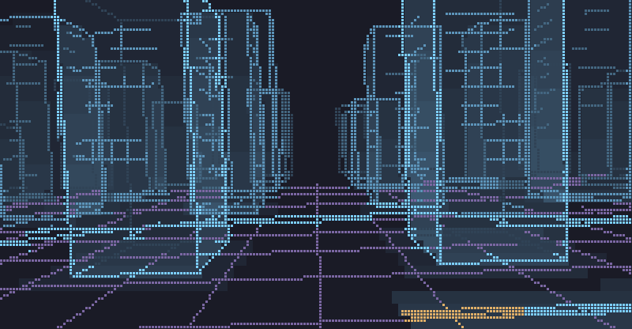
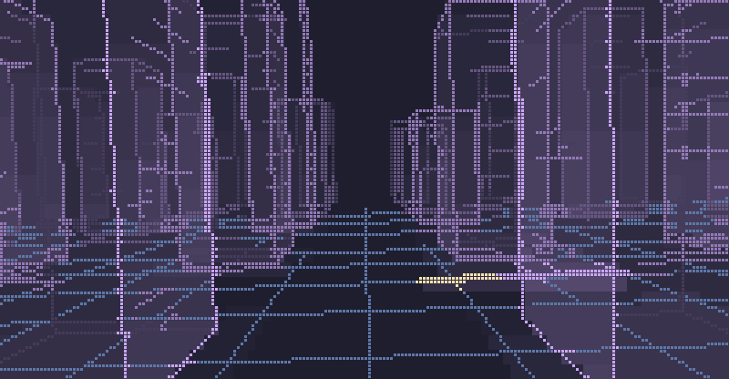
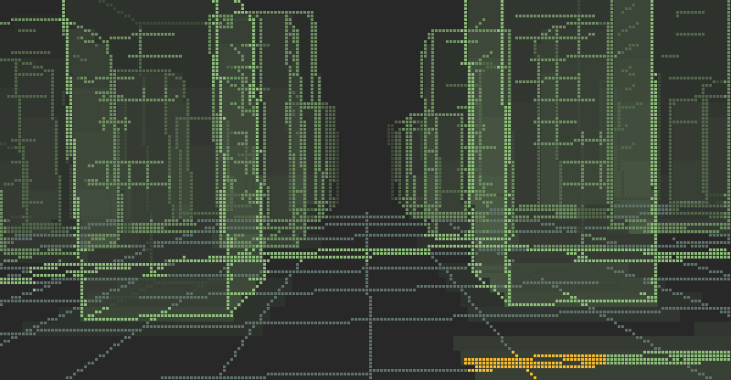
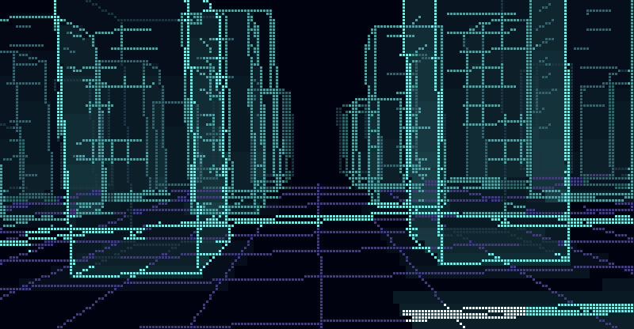
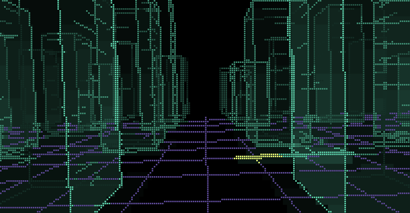

# cliamp-plugin-hackthegibson

A flight through a city of glass towers for [cliamp](https://github.com/bjarneo/cliamp), after the film Hackers (1995). The edges of the towers and the code on them are Braille dots, the glass is a tint of the cells behind them. All colors are yours to set.

The eye flies low through the streets of an endless city and turns at the crossings. It flies one block per beat; without a beat it cruises. A kick sends a pulse of light along the ground, a snare runs a frame of light up or down the towers, a hi-hat lights lines of code, and a sudden jump in energy lifts the eye above the roofs for a moment. Each tower belongs to one band of the spectrum: it grows a little and its glass gets denser while that band is loud.

The scene follows my CSS demo [Hack The Gibson](https://codepen.io/konstantindenerz/pen/poYmNxw).

## Install

```sh
cliamp plugins install konstantindenerz/cliamp-plugin-hackthegibson
```

Start cliamp and press `v` until you reach `Hack the Gibson`, or pick it with `Ctrl+V`. Press `V` for full screen. To start with it, set `visualizer = "Hack the Gibson"` in `config.toml`.

```sh
cliamp plugins remove hackthegibson
```

## Themes

The colors of a terminal have no shades, and the towers need them: the far ones fade, and their glass is a tint. So the plugin comes with themes.

Press `Ctrl+T` in cliamp to step to the next theme. The status bar shows its name, and the plugin keeps it for the next start. The key is in the list of `Ctrl+K` too.

| Theme | |
|---|---|
| `mechanoonna` |  |
| `tokyo-night` |  |
| `catppuccin` |  |
| `gruvbox` |  |
| `hackers` |  |
| `codepen` |  |

`mechanoonna` is the default: the amber and red of the Ghostty theme [Mechanoonna](https://github.com/HANCORE-linux/omarchy-mechanoonna-theme). `catppuccin` is Mocha, `gruvbox` the dark one. `codepen` has the colors of the CSS demo. A seventh theme, `terminal`, takes the cyan, blue, red and yellow of the terminal itself; see below for what that costs.

`hackers` follows the Gibson of the film, which was a model, as its makers tell it: blocks of perspex with text on cels, shot by a motion control camera at Pinewood. Its towers have pale cyan text on teal glass, the traces of the ground are blue-violet, the bars that mark a directory are violet, the pulses on the ground are white, and the towers turn red when the virus strikes: that is the drop here. The colors are measured from stills of the film, so they are near, not exact.

You can name the theme in `~/.config/cliamp/config.toml` instead:

```toml
[plugins.hackthegibson]
theme = "tokyo-night"
```

The name may be written as you like: `Tokyo Night`, `tokyo_night` and `tokyonight` are the same theme, and so are `catppuccin-mocha` and `gruvbox-dark`. A name that the plugin does not know gives the default theme and a line in `~/.config/cliamp/plugins.log`. Of the key and the config, the last act counts: a step of the key goes before the theme of the config, until you change that.

From a shell, `cliamp plugins call "Hack the Gibson" theme tokyo-night` puts a theme on in the running player, and without a name it lists the themes.

The key needs the `keymap` permission, which `cliamp plugins install` and `cliamp plugins trust` show. It is the only permission of the plugin.

## Configuration

The plugin needs no configuration. These keys are optional; the values below are the defaults:

```toml
[plugins.hackthegibson]
theme = "mechanoonna"
# The key that steps through the themes, or "off" for none.
theme_key = "ctrl+t"
# Wait this long before the city reacts, when it is ahead of the sound.
delay_ms = 0
# The speed of the flight: 0.5 is half of it, 2 twice; 0.25 to 2.
speed = 1
```

A theme of your own is five colors, and two more if you like. Each of these keys replaces the color of the theme, so copy the block and change what you like:

```toml
[plugins.hackthegibson]
tower = "#e7c07c" # the towers and their code
floor = "#c5564a" # the grid of the ground
beat = "#d94e38"  # the frames of light of a snare, and a drop
hot = "#fff8e8"   # the heads of the pulses of a kick
back = "#1c1b19"  # the background of the terminal
# drop = "#d94e38" # the towers and their glass in a drop; else as beat
# glass = "#e7c07c" # the glass; else as tower
```

Set `back` to the background of your terminal: the towers far away fade into it, and the glass is a background color between it and the color of the towers. With another `back` the far towers and the thin glass stand out as dark or bright cells. The shades need a terminal with 24-bit color.

A color may be a palette index (0-255) instead of `#rrggbb`; the theme `terminal` is made of those. Such a color follows the theme of the terminal, but it has no shades: the towers are faint far away and take the bright color of the same name when near, 14 for 6, and their glass is a grid of dots.

The glass has a key of its own, `glass`: `"dots"` gives the grid of dots to towers of any color, `"off"` gives none, `"#rrggbb"` gives glass of another color than the towers, and a palette index gives one flat background color.

## Notes

- The plugin reads the tempo from how the whole spectrum rises and falls, not from the kicks alone, so it also finds the beat of a break or of a track without drums. The bands do not tell a beat from half or twice of it, so the plugin takes the one between 85 and 170 BPM. In calm music it takes the one between 55 and 110 BPM, so lo-fi flies slowly; calm is music with next to nothing above 6 kHz, as lo-fi is. `speed` in the config makes the flight slower or faster for all music.
- Kick, snare and hi-hat come from 10 bands, 20 times a second. That does not tell everything apart: the body of a snare sounds like a kick, so a snare sends a pulse along the ground too, and a track without a snare gets a frame of light now and then from whatever else rises in the mids.
- The drums need a cliamp that gives plugins the sound as it plays ([bjarneo/cliamp#738](https://github.com/bjarneo/cliamp/pull/738)). Up to v2.4.1 a plugin gets the audio in bursts and ahead of the sound. With synthetic drum tracks the plugin then finds 56 to 83% of the kicks, about 150 ms before they sound; with the change it finds 95 to 100%, 40 ms after. `delay_ms = 175` lines up the kicks that an older cliamp does catch. The tempo holds either way.
- The terminal font needs the Braille block (U+2800 to U+28FF).
- cliamp gives a plugin 50 ms for a frame. A full-screen frame at 140x40 takes about a third of that on an Apple M-series CPU. When frames get slow, the plugin shows less of the city far away to stay in time.
- A low panel shows only the towers nearby. The city looks best in full screen.
- While playback is paused the eye eases to a stop. Silence stops it too.

## Development

```sh
cp hackthegibson.lua ~/.config/cliamp/plugins/
cliamp plugins trust hackthegibson
```

cliamp loads plugins at start and asks for the trust step again after each edit. Errors go to `~/.config/cliamp/plugins.log`.

The tests run the plugin in the Lua VM that cliamp uses, with stand-ins for cliamp:

```sh
cd test && go test ./...
```

`test/testdata/bands` holds what cliamp makes of synthetic drum tracks: the bands of each tick, and when the drums hit. The tests check that the plugin finds the drums and the tempo in them. `test/probe` recorded them: it mixes the tracks, runs them through the spectrum analysis of cliamp and into the plugin, and prints how many hits the plugin finds. It needs a checkout of cliamp with the change above next to this repository, as `go.mod` there says:

```sh
cd test/probe
go run . ../../hackthegibson.lua                            # the report
go run . -record ../testdata/bands ../../hackthegibson.lua  # record the bands again
go run . -pcm dir ../../hackthegibson.lua                   # music of your own: *.f32, mono, 44.1 kHz
```

After a change that is meant to alter the picture, `go test -update` records the frames in `test/testdata/frames.txt` again. `go test -run TestShots -shots=/tmp/shots` writes some frames as PNG files, to look at without cliamp. `go test -run TestGallery -themes=../assets/themes` draws the pictures of the themes again.

## License

MIT
